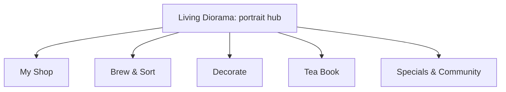

# Decopu (デコプ) — v1.0.0 Stitch product map

Recorded 2026-11-08 from the owner's supplied Stitch concept. The owner requested keeping this material in the project notes for v1.0.0.

**Status: future product/design input.** This captures the proposed experience and systems; it is not an implementation specification, a committed v1.0.0 feature list, or evidence that these systems exist. The current release is 0.3.1. Current behavior and agreed rules remain in [PRODUCT.md](PRODUCT.md), delivery priorities in [ROADMAP.md](ROADMAP.md), and implemented architecture in [ARCHITECTURE.md](ARCHITECTURE.md).

## Part 1 — Living Diorama and connected systems

The proposed compact, portrait, single-screen **Decopu — Living Diorama** is the central hub, with deeper systems reached through contextual surfaces. Stitch cites Genshin Impact, Animal Crossing: Pocket Camp, Neko Atsume and Tsuki's Odyssey as examples of a clean central mobile experience branching into larger systems. These are source references, not a decision to copy their mechanics or visual design.

The core stage combines:

- A live isometric tea-shop viewport.
- An active tea-sorting puzzle tray.
- Real-time ambience and quick guest orders.

| Proposed entry | Systems and content described by Stitch |
| --- | --- |
| 🏮 My Shop — bottom tab 1 | Shop progression, upgrade tiers, revenue and staff |
| 🍵 Brew & Sort — bottom tab 2 | Extended puzzle stages, mortar and pestle, rare blends |
| 🪴 Decorate — bottom tab 3 | Room themes, furniture shop and tatami layout |
| 📖 Tea Book — bottom tab 4 | Herb compendium, guest scrapbook and story memories |
| ✨ Specials & Community — floating events | Harvest Moon Festival, Village Sanctuary Map and asynchronous co-op |

The four-tab structure, labels, simultaneous room/puzzle composition and contextual surfaces are design proposals to explore, not a replacement already approved for the reviewed interface.

### Contextual access to extras, specials and community

**Event ribbons and spatial banners.** When an event such as Harvest Moon Festival is active, an unobtrusive seasonal banner could appear above the diorama, or a festival lantern could light up inside the courtyard. Tapping it opens a dedicated event overlay sheet. The source refers to upper-right festival pins; no corresponding Stitch screen/image was supplied with these notes. A courtyard and seasonal event system are proposed additions.

**Tea Book drawers/sheets.** The Tea Book could contain a Guest Scrapbook, Friendship Profiles, letters from patrons and unlocked memory snapshots. Example characters are **Pippa Hedgehog** and **Grandma Willow**.

**Decoration drawers/sheets.** Decorate could switch between themes such as **Rainy Veranda**, **Kyoto Bamboo** and **Botanical Greenhouse**, and let players place earned furniture. The source's phrase “earned furniture” does not settle a new grant or purchase rule; current catalogue decorations cost earned stars and included styles are free to change.

**Village Sanctuary / Community Map.** A cobblestone-path icon in the top header could connect the shop to neighboring players' teahouses. Proposed interactions include exchanging rare dried herbs, sending tea canisters and leaving warm visitor notes.

## Part 2 — Proposed context for AI systems

Stitch frames tactile crafting, sensory aesthetics, storybook personalities and social gifting as potential structured context for adaptive storytellers, autonomous NPC villagers, tea-sommelier generation and procedural events. The source calls this “feed your AI.” The following are proposed input/output relationships, not existing telemetry, implemented AI behavior or a decision to transmit player data.

### 1. Sensory memory and living NPC personalities

**Possible inputs:** which leaves the player brewed, steeping temperature (for example **94°C**), time-of-day ambience (**Morning Sun** or **Amber Dusk**) and sound setting (**Rain** or **Lo-Fi Koto**), together with recipe history and friendship state.

**Proposed outputs:**

- **Dynamic guest memories.** Use Grandma Willow's friendship rank, illustrated as **Level 4 Soul Teammate**, and the player's recipe history to write warm personalized diary entries or gratitude letters delivered through a **Village Tea Mailbox**.
- **Mood-sensitive dialogue.** With **Gentle Eaves Rain** at night, visitors could share reflective poetry or cozy secrets responding to the room's ambience.

Named characters, ranks, temperatures, sound presets and dialogue are examples from the concept, not finalized content or present gameplay values.

### 2. Procedural artisanal tea and tisane generation — Apothecary Engine

**Possible inputs:** harvested botanical ingredients such as **Dried Persimmon**, **Cassia Bark**, **Moon Dew** and **Lavender sprigs**, plus puzzle-sorting outcomes.

**Proposed outputs:** an AI **Master Tea Sommelier** generates whimsical blend names, poetic tasting notes, restorative aura buffs and custom illustrated tea cards for the **Tea Book Compendium**. The source invokes **Sen no Rikyu** as its sommelier reference and gives the tasting-note example **“Notes of roasted cedar smoke and honeyed autumn mist.”**

Harvesting, recipes, aura effects and generated cards are proposed systems. Their gameplay effects and relationship to puzzle/star progression remain to be designed.

### 3. Adaptive puzzle and journey balancing

**Possible inputs:** move-count efficiency, Undo frequency, preferred tea-colour aesthetics and play pacing.

**Proposed outputs:** custom sorting stages matched to a player's cognitive rhythm, with harmonious colour layers and difficulty intended to sustain flow and reduce stress. Stitch specifically suggests “calibrating move limits.”

**Existing-rule boundary:** current move counts affect star targets; there is no move-cap failure, clock or fail state, and Undo is unlimited. Recording the source's move-limit suggestion does not authorize introducing a cap or changing those rules. Generated stages, adaptation, scoring, solvability validation and compatibility with existing board identities/saves need a separate design. Human pacing evidence is still pending; solver minima alone do not establish enjoyable difficulty.

### 4. Asynchronous community storyteller — Village Chronicle

**Possible inputs:** teahouse visits, gifted herb bundles and visitor notes left at friends' shops.

**Proposed outputs:** weekly illustrated storybook issues of the **Decopu Village Chronicle**, narrating how neighboring teahouses influenced one another, which seasonal teas were popular and collaborative community harvest milestones.

This proposes both community activity and a recurring generated publication. Neither is currently implemented or scheduled by recording these notes.

## Relationship to the released game and unresolved choices

**Current foundation:** normal 3D sorting puzzles, the Babylon.js shop, earned-star decoration purchases, free included styles, explicit room editing and local progress. Main and preview saves are separate. Current ambient guests have no implemented friendship ranks, recipe memories, order economy or autonomous AI dialogue.

**Agreed action in this session:** preserve this Stitch product map as v1.0.0 planning input and make it discoverable from the roadmap. No implementation, UI replacement, backend, AI integration, data collection, multiplayer rollout or save migration is started by this documentation update.

**Unresolved design/technical choices:**

- Which proposed systems belong in v1.0.0, their delivery order and the first testable slice.
- Final hub composition/navigation, including how a visible room and a complete four-/five-slot puzzle fit small phones.
- The role of guest orders, staff, revenue, harvesting, recipes and aura buffs in the existing earned-star economy and relaxed game loop.
- AI provider/runtime, input schema, local versus remote processing, player control over stored/shared context, generation cost/latency and behavior when generation is unavailable.
- Community identity/storage, gifting and visitor-note behavior; generated-story boundaries and how shared material is selected.
- Generated-puzzle validation, scoring and progression compatibility while retaining no fail state and unlimited Undo.

The existing iPhone startup investigation, physical-device performance/accessibility checks and uncoached first-session testing remain pending. Bakery remains a placeholder; this concept does not implement or separately approve it. The supplied Stitch text also does not select a final art palette or confirm retention/performance benefits.
